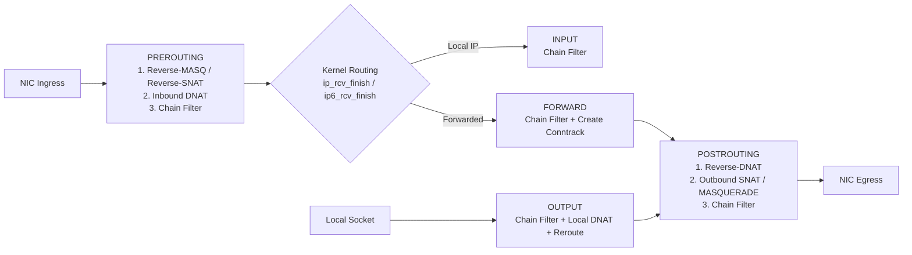

# 03 — `sfw.ko` Dual-Stack Socket Broker, 5-Chain Firewall & Stateful NAT

`sfw` (**Socket Firewall**) completely replaces Netfilter (`CONFIG_NETFILTER is not set`) across both **IPv4 (`AF_INET`)** and **IPv6 (`AF_INET6`)**. It consists of two tightly integrated layers inside `modules/sfw/sfw.ko` plus userspace client libraries and the `sfw` CLI:

1. **Root-Owned `AF_UNIX` Kernel Socket Worker (`sfwd`)** ([modules/sfw/sfw_main.c](../modules/sfw/sfw_main.c)) — Converts all userspace localhost (`127.0.0.1` / `::1`) and external IP/device socket operations into authenticated local `AF_UNIX` streams at `/run/pressure/sfw/mux.sock`.
2. **Live Dual-Stack 5-Chain Packet Filter & Stateful NAT44/NAT66 Engine** ([modules/sfw/sfw_nat_fwd.c](../modules/sfw/sfw_nat_fwd.c)) — Inspects, filters, state-tracks, and NAT-rewrites routed and local IPv4/IPv6 packets at runtime via `/proc/pressure_sfw/*`.

---

## 1. Root-Owned `AF_UNIX` Socket Broker (`sfw_main.c`)

### 1.1 Why Raw IP Sockets Are Blocked
In `pressure_socket_create()` ([lsm_hooks.c](../security/pressure/lsm_hooks.c#L482-L510)), userspace processes in `init_net` are hard-stopped from creating `AF_INET`, `AF_INET6`, or `AF_PACKET` sockets (`PVIO_RAW_IP_SOCKET`, `-EACCES`). Only kernel sockets (`kern == 1` / `PF_KTHREAD`) created by `sfwd` are permitted to touch the TCP/IP stack.

### 1.2 Lifecycle & Mount-Context Binding
- During `insmod sfw.ko`, `sfw_init()` ([sfw_main.c](../modules/sfw/sfw_main.c#L653-L711)) creates, binds, and listens on `/run/pressure/sfw/mux.sock` (`0666` permissions, owned by `uid=0`) inside `insmod`'s live mount root before spawning the `sfwd` accept kthread and registering it via `pressure_register_sfw_worker()`.
- For each accepted `AF_UNIX` client stream, `sfwd` spawns a dedicated `sfw_conn` worker (`sfw_conn_worker()`) that extracts the client's unforgeable kernel credentials (`usk->sk_peer_cred` and `usk->sk_peer_pid`).

### 1.3 `SFW2` Wire Operations (`0x53465732U`)
Every request sends `struct sfw_req_hdr` ([sfw.h](../include/uapi/linux/sfw.h#L97-L121)) and receives `struct sfw_resp_hdr`:

| Opcode | Handler Behavior in `sfw_conn_worker()` |
| :--- | :--- |
| `SFW_OP_OPEN` (`1`) | Creates kernel-owned `AF_INET` or `AF_INET6` socket (`sock_create_kern`), enables `SO_REUSEADDR`, returns random 64-bit `handle_token`. |
| `SFW_OP_BIND` (`2`) | Calls `pressure_sfw_authorize()` (IPv4) or `pressure_sfw_authorize6()` (IPv6) with `SFW_DIR_BIND`; binds socket to `"lo"` (if loopback) or requested `ifname` via `sock_bindtoindex()`, then `kernel_bind()`. |
| `SFW_OP_LISTEN` (`3`) | Calls `kernel_listen()` and registers `ctx` in `listener_list` keyed by `(token, owner_pub_uid)`. |
| `SFW_OP_ACCEPT` (`4`) | Opens a new `AF_UNIX` stream, verifies `listener_token` ownership, accepts the inbound TCP peer, authorizes `SFW_DIR_RECV`, and **automatically taints `peer_task` as `REMOTE` (`pressure_taint_task_remote`) if the peer IP is non-loopback** (`!127.0.0.0/8` and `!::1`). |
| `SFW_OP_CONNECT` (`5`) | Applies any live local `DNAT` rule (`sfw_apply_broker_dnat` / `sfw_apply_broker_dnat6`), checks `SFW_DIR_CONNECT` authorization, binds to target `net_device`, and runs `kernel_connect()`. |
| `SFW_OP_SEND` (`6`) | Authorizes `SFW_DIR_SEND` on every write and transmits payload via `kernel_sendmsg()`. |
| `SFW_OP_RECV` (`7`) | Authorizes `SFW_DIR_RECV`; if the connection is external (`ctx->remote_peer`) or carries remote taint flag `0x8000`, taints the receiving task `REMOTE` before returning payload bytes. |
| `SFW_OP_CLOSE` (`8`) | Releases the underlying kernel IP socket and closes the `AF_UNIX` channel. |
| `SFW_OP_SENDTO` (`9`) | Connectionless UDP (`SOCK_DGRAM`) datagram transmit with per-destination `sfw` & `DNAT` evaluation + `SFW_FLAG_NONBLOCK`. |
| `SFW_OP_RECVFROM` (`10`) | Connectionless UDP receive returning sender IPv4/IPv6 address & port, enforcing `SFW_DIR_RECV` and tainting `REMOTE` on non-loopback peers. |
| `SFW_OP_POLL` (`11`) | Queries `ip_sock->ops->poll()` readiness (`EPOLLIN\|EPOLLOUT\|EPOLLERR\|EPOLLHUP`) for `poll()` and native adapters. |
| `SFW_OP_GETSOCKNAME` / `GETPEERNAME` (`12`, `13`) | Returns bound local socket address (including ephemeral `:0` ports) or connected peer address. |
| `SFW_OP_SETSOCKOPT` (`14`) | Applies whitelisted socket options (`SO_REUSEADDR`, `SO_REUSEPORT`, `SO_KEEPALIVE`, `SO_BROADCAST`, `TCP_NODELAY`, `IPV6_V6ONLY`). |
| `SFW_OP_SHUTDOWN` (`15`) | Performs clean TCP half-close (`SHUT_RD`, `SHUT_WR`, `SHUT_RDWR`). |

### 1.4 Default `sfw` Authorization Invariance
Even with zero explicit rules loaded in `/sys/kernel/security/pressure/sfw_rules`:
- **Loopback (`127.0.0.0/8` and `::1/128` on `lo` / `dev:net_lo`)** is **ALLOWED** in both `PRELOGIN_LOCAL` (so `systemd` and boot services function before login) and `AUTH_LOCAL` (authenticated local user sessions), and **HARD-STOPPED** for `REMOTE` tasks!
- **All External IPv4 and IPv6 Addresses** are **DEFAULT-DENY** unless explicitly permitted by an `sfw_rules` entry matching direction, `pub_uid`, CIDR/prefix, port range, device label, and `max_prov`.

---

## 2. Live Dual-Stack 5-Chain Firewall & Stateful NAT44/NAT66 (`sfw_nat_fwd.c`)

### 2.1 Packet Processing Pipeline
`sfw_ipv4_pkt_hook()` and `sfw_ipv6_pkt_hook()` execute at all 5 kernel hook points on `&init_net`:



### 2.2 Dual-Stack Stateful Connection Tracking (`conntrack` & `conntrack6`)
- Maintains dual hash tables for IPv4 (`ct_orig_ht`, `ct_reply_ht`) and IPv6 (`ct6_orig_ht`, `ct6_reply_ht`), up to `2048` entries each with automatic `120 * HZ` idle expiration.
- **Post-`PREROUTING` Hash Bucket Invariance**: Buckets are keyed on `(proto, saddr, sport)` (`hash_tuple` / `hash_tuple6`), and `orig_tuple*_matches()` / `reply_tuple*_matches()` match both pre-translation and post-`PREROUTING` translated `(daddr, dport)` pairs. This ensures `FORWARD` and `POSTROUTING` recognize `ESTABLISHED` flows immediately after `PREROUTING` rewrites `daddr:dport`.
- **IPv6 Neighbor Discovery (NDP) Permit**: Unlike IPv4 ARP (`ETH_P_ARP`), IPv6 Neighbor/Router Discovery runs inside `IPPROTO_ICMPV6`. `extract_tuple6()` automatically permits ICMPv6 types `130..136` (MLD, Router Solicitation/Advertisement, Neighbor Solicitation/Advertisement) and `143` (MLDv2) so L2 neighbor resolution works seamlessly even when `input` or `forward` default policy is `DROP`.

### 2.3 NAT44 & NAT66 Header and Checksum Rewriting
- **IPv4 (`rewrite_ipv4_l4`)**: Uses `skb_ensure_writable()`, updates `iph->check` via `csum_replace4()`, updates TCP/UDP pseudo-header checksums via `inet_proto_csum_replace4(..., true)` and port checksums via `inet_proto_csum_replace2(..., false)`. Dynamic `MASQUERADE` selects the outgoing interface IP via `inet_select_addr(out_dev, tup.daddr, RT_SCOPE_UNIVERSE)`.
- **IPv6 (`rewrite_ipv6_l4`)**: Walks any standard IPv6 extension headers (`HOP`, `ROUTING`, `DEST`) to locate the L4 header, rewrites `ip6h->saddr` or `ip6h->daddr`, and updates TCP, UDP, and ICMPv6 pseudo-header checksums via `inet_proto_csum_replace16(..., true)` and port checksums via `inet_proto_csum_replace2(..., false)`. Dynamic IPv6 `MASQUERADE` selects the outgoing source address via `ipv6_dev_get_saddr(net, out_dev, &tup.daddr, 0, &new_src6)`.
- **Local `OUTPUT` `DNAT` Rerouting**: When an `OUTPUT` `DNAT` rule rewrites a locally originated packet's destination IP, `reroute_output_skb()` (`ip_route_output_key`) or `reroute_output_skb6()` (`ip6_route_output`) drops the stale `dst_entry` and attaches the new route before `POSTROUTING`.

### 2.4 `/proc/pressure_sfw/` Runtime Control Interface
| Procfs File | Mode | Purpose & Write Commands |
| :--- | :---: | :--- |
| `/proc/pressure_sfw/chains` | `0600` | Read: chain policies + IPv4/IPv6 rules & hit counters.<br/>Write: `flush`, `policy <chain> <accept\|drop>`, or `add <chain> <allow\|drop> <proto> <in_dev> <out_dev> <src_cidr> <dst_cidr> <pmin> <pmax> <any\|new\|established>`. |
| `/proc/pressure_sfw/nat` | `0600` | Read: active NAT44/NAT66 rules & translated flow counts.<br/>Write: `flush`, `add masquerade <out_dev> <src_v4_or_v6_cidr>`, `add snat <proto> <out_dev> <src_cidr> <snat_ip>`, or `add dnat <proto> <in_dev> <dst_cidr> <dport> <new_ip> <new_port>`. |
| `/proc/pressure_sfw/conntrack` | `0400` | Read: live IPv4 & IPv6 stateful flows (`SYN_SENT/NEW` vs. `ESTABLISHED`), NAT type, original/reply tuples, packet & byte counters. |
| `/proc/pressure_sfw/stats` | `0444` | Read: `sfw_ready`, `sfw_policy_gen`, `sfw_txn_active`, total `nat_header_rewrites`, and per-chain `accepted` / `dropped` packet totals. |
| `/proc/pressure_sfw/txn` | `0200` | Write: `begin`, `commit`, or `abort` (`CAP_NET_ADMIN`) for atomic snapshot/rollback of chain policies, chain rules, and NAT rules. |

---

## 3. Userspace Libraries & `sfw` CLI

### 3.1 `libpressuresock` ([libpressuresock.h](../userspace/libpressure/libpressuresock.h), [libpressuresock.c](../userspace/libpressure/libpressuresock.c))
Direct C API speaking `SFW2` over `/run/pressure/sfw/mux.sock`:
- `pg_socket(domain, type, protocol)` (`AF_INET` or `AF_INET6`)
- `pg_bind_sa` / `pg_bind` (IPv4) / `pg_bind6` (IPv6)
- `pg_listen(ufd, &listener_token)`
- `pg_accept_sa` / `pg_accept` (IPv4) / `pg_accept6` (IPv6)
- `pg_connect_sa` / `pg_connect` (IPv4) / `pg_connect6` (IPv6)
- `pg_send`, `pg_recv`, `pg_close`

### 3.2 `libpressureshim.so` ([libpressureshim.c](../userspace/libpressure/libpressureshim.c))
`LD_PRELOAD` shared library interposing `socket`, `bind`, `listen`, `accept`, `accept4`, `connect`, `send`, `recv`, and `close` for both `AF_INET` and `AF_INET6` so unmodified binaries transparently route IP sockets through `sfwd`.

### 3.3 `sfw` CLI ([sfw_cli.c](../userspace/sfw/sfw_cli.c))
```bash
# Inspect all socket rules, 5-chain policies/rules, NAT44/NAT66 rules, conntrack, and counters
sfw status
sfw conntrack
sfw stats

# Add AF_UNIX socket worker rules (IPv4 netmask or IPv6 prefix/CIDR)
sfw allow connect 0 192.0.2.0 255.255.255.0 443 443 dev:net_ext 1
sfw allow connect 0 2001:db8::/64 443 443 dev:net_ext 1

# Live chain policies & stateful rules (IPv4 & IPv6)
sfw chain policy forward drop
sfw chain add forward allow tcp veth-lan veth-wan fd00:10::/64 fd00:20::/64 8086 8086 new
sfw chain add forward allow all * * * * 0 65535 established

# Live NAT44 & NAT66 (MASQUERADE, SNAT, DNAT port-forwarding)
sfw nat add masquerade veth-wan 10.10.1.0/24
sfw nat add masquerade veth-wan fd00:10::/64
sfw nat add dnat tcp veth-wan 192.0.2.1/32 8088 10.10.1.2 9090
sfw nat add dnat tcp veth-wan fd00:20::1/128 8089 fd00:10::2 9091
```
