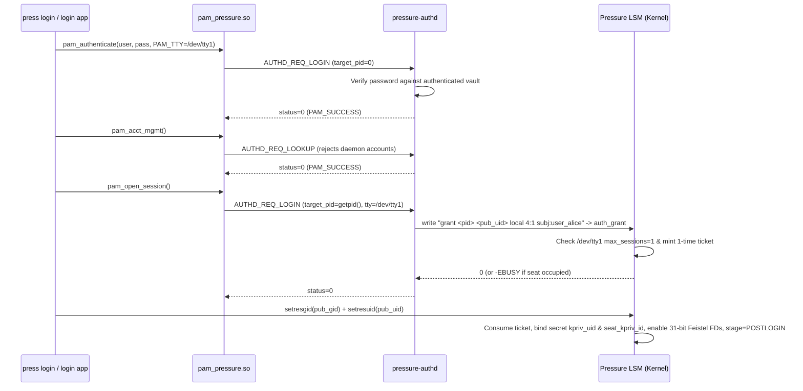

# 04 — `pressure-authd`, `pam_pressure.so` & `press`

Pressure replaces the legacy Unix password/shadow authentication stack with a dedicated `systemd` authentication daemon (**`pressure-authd`**) and custom PAM module (**`pam_pressure.so`**), while maintaining full compatibility with legacy POSIX tools that look up usernames in `/etc/passwd` and `/etc/group`.

---

## 1. `pressure-authd` (`userspace/authd/pressure_authd.c`)

Implemented in [pressure_authd.c](../userspace/authd/pressure_authd.c) with RPC definitions in [authd_proto.h](../userspace/authd/authd_proto.h) and `systemd` unit [pressure-authd.service](../userspace/systemd/pressure-authd.service).

### 1.1 Exclusive Kernel Credential (`PRESSURE_ACCT_AUTHD`)
On startup, `pressure-authd` writes `"register\n"` to `/sys/kernel/security/pressure/authd_register`.
- The kernel verifies no other live process holds `pressure_authd_pid`, sets `ncb->account_type = PRESSURE_ACCT_AUTHD` and `ncb->label = "subj:pressure_authd"`, and locks `/sys/kernel/security/pressure/users` and `auth_grant` exclusively to `pressure-authd`.

### 1.2 Cryptographic Vault (`/etc/pressure/auth.vault`)
Instead of storing password hashes in `/etc/shadow`:
1. **Master Key (`/etc/pressure/master.key`)**: Generated once from OpenSSL CSPRNG (`RAND_bytes`, 256 bits) and immediately kernel-locked with `PRESSURE_FILE_AUTHD_VAULT`.
2. **HKDF-SHA-256** derives a 256-bit vault key using the `pressure-vault-v2` salt and `aes-256-gcm` context.
3. **AES-256-GCM** encrypts the account table with an OpenSSL-generated 96-bit nonce and a 128-bit authentication tag. The authenticated header includes the format version and record count.
4. **PBKDF2-HMAC-SHA-256** derives new and reset password verifiers with 600,000 iterations and a fresh 256-bit salt. Verification compares the result in constant time.

Back up `master.key` and `auth.vault` together before upgrading. In the default OpenSSL profile, authd reads the old ChaCha20-Poly1305 vault and atomically writes its AES-GCM replacement. The prior authd version expects the old format. Legacy scrypt accounts remain usable until an administrator resets their passwords with `pressure-authctl passwd --password-stdin USERNAME`. Reset every legacy password before moving to FIPS mode.

Use `pressure-authd --require-fips` or install a root-owned, non-writable-by-group-or-others regular file at `/etc/pressure/require-fips` to require strict mode on each daemon start. Configure OpenSSL to activate its FIPS provider and set `fips=yes`. Run `pressure-authd --check-fips` in the target root to check provider selection and run the random generator and both key derivation paths before starting the daemon. Strict startup also refuses legacy vault crypto and scrypt verifiers. Deployments requiring FIPS 140-3 must select a validated provider and follow its security policy for the operating environment. [NIST validated modules](https://csrc.nist.gov/Projects/Cryptographic-Module-Validation-Program/Validated-Modules)
5. **Kernel Hard-Stop on Vault & Manifest Files**: `/etc/pressure/master.key`, `/etc/pressure/auth.vault`, and `/etc/pressure/posix.manifest` all carry `PRESSURE_FILE_AUTHD_VAULT`. Even `root` (`uid=0`) outside `pressure-authd` receives `-EACCES` (`AUTHD_VAULT_HARDSTOP`) if it attempts to open them. Every write uses same-directory `mkstemp` + `fchmod(0600)` + `fsync` + atomic `rename` + directory `fsync`.

Authd applies the kernel vault label to each temporary inode before it
writes or renames the file. A labeling or random ID failure aborts the
write and removes the temporary file.

### 1.3 Non-Sequential Random Public UIDs, Distro Coexistence & Atomic POSIX Sync
- **Never `1000, 1001...`**: `generate_random_public_id()` draws collision-free CSPRNG 31-bit values in `[100,000 .. 2,147,000,000)` for **both human users and system daemons** (`pub_uid` and `pub_gid`), scanning both `g_accounts[]` and existing `/etc/passwd` + `/etc/group` entries so generated IDs never collide with distro-assigned UIDs/GIDs.
- **Secret Kernel Pairing**: `register_account_in_kernel()` writes `add <pub_uid> <pub_gid> <human|daemon> <label>` to `/sys/kernel/security/pressure/users`, causing the kernel to mint a secret 64-bit `kpriv_uid` / `kpriv_gid` never exposed to userspace. Preexisting distro/package accounts are **never** registered in `users` or `auth.vault` and never gain Pressure credentials or interactive PAM login rights.
- **Private Home & Daemon State Directories**: Creates `/home/<user>` (tagged `PRESSURE_FILE_USER_PRIVATE | PRESSURE_FILE_LOCAL_ONLY`) or `/var/lib/<daemon>` (tagged `PRESSURE_FILE_USER_PRIVATE`), locking all files created inside to that account's secret `kpriv_uid`.
- **Distro-Safe POSIX Merge (`sync_posix_files`)**:
  - **External Ownership Manifest (`/etc/pressure/posix.manifest`)**: Pressure tracks its owned usernames outside `/etc/{passwd,group,shadow}` (never embedding `#` comment lines that break `pwck`/`grpck` or RPM shadow-utils).
  - **Clean First-Boot No-Op**: When no Pressure accounts exist yet (`auth.vault` empty and `posix.manifest` empty) and `/etc/{passwd,group,shadow}` already exist with a `root:` entry, `sync_posix_files()` does not modify `/etc`.
  - **Verbatim Preservation**: On merge, every non-Pressure line in `/etc/passwd`, `/etc/group` (including supplementary group member lists such as `wheel:x:10:root,ops`), and `/etc/shadow` is preserved verbatim, along with original file ownership and mode bits (including EL10's `0000` mode on `/etc/shadow`). Supplementary members added to a Pressure-owned group are also preserved across refreshes.
  - **Collision Rejection**: `AUTHD_REQ_USERADD` rejects any name already present in `/etc/passwd`, `/etc/group`, or `/etc/shadow` with `-EEXIST`. On startup/reboot, `check_vault_posix_collisions()` refuses to clobber any non-Pressure entry sharing a Pressure account's name, UID, or GID.
  - **Atomic 4-Phase Swap & Crash Recovery**: All three `/etc` files are staged via `mkstemp` + `write_all` + `fchown`/`fchmod` + `fsync`, backed up via same-directory hardlinks (`/etc/.pressure_bak_{passwd,group,shadow}`) + `/etc` `fsync`, swapped via `rename()`, followed by atomic `/etc/pressure/posix.manifest` persistence before unlinking backups. Any error rolls back all already-swapped files immediately; on startup after a mid-swap crash, `recover_interrupted_posix_sync()` restores leftover `.pressure_bak_*` snapshots before reconciling against `auth.vault`.

### 1.4 `authd.sock` IPC Operations (`AUTHD_PROTO_MAGIC = 0x50415554U`)
Listening at `/run/pressure/authd.sock`, `handle_client()` verifies caller `SO_PEERCRED` (`peer.uid == 0` required for admin mutations) and serves:

| Opcode | Name | Purpose |
| :---: | :--- | :--- |
| `1` | `AUTHD_REQ_USERADD` | Creates human or `--daemon` account, random `pub_uid`/`pub_gid`, provisions private dir, syncs `/etc/passwd` & vault. |
| `2` | `AUTHD_REQ_PASSWD` | Re-salts and updates the PBKDF2 password verifier in `auth.vault`. |
| `3` | `AUTHD_REQ_GROUPADD` | Reserved group provisioning opcode. |
| `4` | `AUTHD_REQ_SETLABEL` | Updates account's MAC label in `auth.vault` and live kernel `user_table`. |
| `5` | `AUTHD_REQ_LOGIN` | Verifies the account's password; when `target_pid > 0`, resolves `tty_path` `major:minor`, determines `LOCAL` vs. `REMOTE` (`rhost`), and mints a one-time kernel `auth_grant` ticket. |
| `6` | `AUTHD_REQ_START_DAEMON` | Mints a one-time kernel `auth_grant` ticket so a service supervisor can transition `target_pid` into a daemon's `pub_uid` / secret `kpriv_uid`. |
| `7` | `AUTHD_REQ_LOGOUT` | Writes `release_pid <pid>` to `auth_grant`, freeing any claimed seat TTY `max_sessions` slot. |
| `8` | `AUTHD_REQ_LOOKUP` | Returns public account metadata (`pub_uid`, `pub_gid`, `is_daemon`, `label`, `home_dir`). |

---

## 2. `pressure-authctl` CLI (`userspace/authd/pressure_authctl.c`)

Administrative tool ([pressure_authctl.c](../userspace/authd/pressure_authctl.c)) for managing users and daemons:

```bash
# Provision human workstation users (random pub_uid + /home/<user> locked to secret kpriv_uid)
pressure-authctl useradd alice "AliceStrongPass!2026"
pressure-authctl useradd bob   "BobStrongPass!2026" --label subj:user_bob

# Provision confined system daemons (no password login; /var/lib/<daemon> locked to secret kpriv_uid)
pressure-authctl useradd --daemon webd -
pressure-authctl useradd --daemon dbd  -

# Rotate password, update label, or inspect accounts
pressure-authctl passwd alice "NewPassphrase!2026"
pressure-authctl set-label webd subj:web_php
pressure-authctl info alice
pressure-authctl list
```

---

## 3. `pam_pressure.so` (`userspace/pam/pam_pressure.c`)

Installed at `/lib/x86_64-linux-gnu/security/pam_pressure.so` and configured in `/etc/pam.d/pressure-login` without `pam_unix.so` ([pam_pressure.c](../userspace/pam/pam_pressure.c)):

```text
auth     required /lib/x86_64-linux-gnu/security/pam_pressure.so
account  required /lib/x86_64-linux-gnu/security/pam_pressure.so
session  required /lib/x86_64-linux-gnu/security/pam_pressure.so
```



---

## 4. `press` Enforcement & Session Runner (`userspace/press/press.c`)

Implemented in [press.c](../userspace/press/press.c):

| Subcommand | Description |
| :--- | :--- |
| `press boot-init` | Initializes `/run/pressure` and `/run/pressure/sfw` during early boot before `insmod sfw.ko` and `pressure-authd`. |
| `press enforce <on\|off>` | Toggles kernel hard-stop and 3-strike `SIGKILL` enforcement via `/sys/kernel/security/pressure/enforce`. |
| `press login <user> <pass> <tty> [--rhost <ip>] -- <cmd...>` | Authenticates `<user>` through PAM (`pressure-login`), claims `<tty>` (`max_sessions` checked), transitions into `<user>`'s random `pub_uid` + secret `kpriv_uid` + encrypted 31-bit FD mode, executes `<cmd...>`, and releases the session on exit. |
| `press start-daemon <name> [--remote] -- <cmd...>` | Requests a one-time daemon UID ticket from `pressure-authd`, transitions into `<name>`'s random `pub_uid` + secret `kpriv_uid` + encrypted FD mode, and executes `<cmd...>`. |
| `press exec [--origin local\|remote] [--label <lbl>] [--no-fd-enc] -- <cmd...>` | Self-confines the current process via `/sys/kernel/security/pressure/self_confine` without changing UID. |
