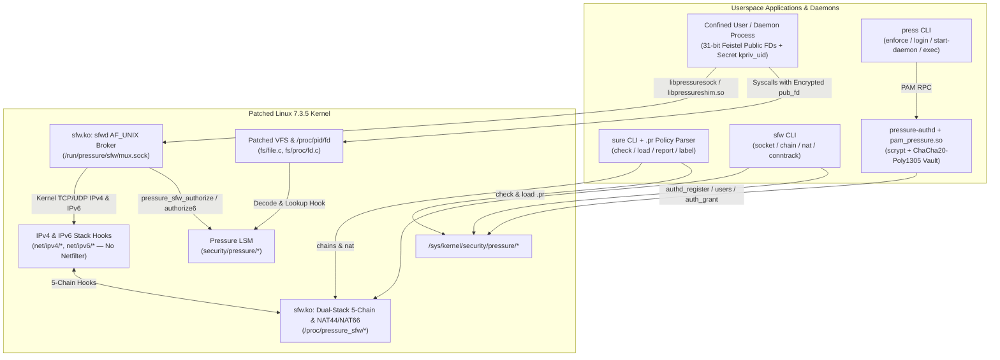

# Pressure Security Architecture & `sfw` — Technical Documentation

This directory documents every kernel patch, Linux Security Module (LSM) component, loadable kernel module (`sfw.ko`), authentication daemon (`pressure-authd`), PAM module (`pam_pressure.so`), library, policy language, and verification harness implemented atop **Linux 7.3.5** on branch `custom-kernel` (baseline tag `v7.3.5`).

---

## Documentation Index

| Document | Scope |
| :--- | :--- |
| **[01-kernel-core-patches.md](01-kernel-core-patches.md)** | Upstream Linux 7.3.5 patches across VFS (`fs/file.c`, `fdtable.h`), `/proc/<pid>/fd`, LSM framework hooks, UAPI headers, Netfilter removal, and dual-stack IPv4/IPv6 5-chain packet hooks. |
| **[02-pressure-lsm.md](02-pressure-lsm.md)** | The `pressure` LSM (`security/pressure/`): 30-bit SipHash Feistel FD cipher, 3-strike `SIGKILL` audit engine, secret kernel UIDs (`kpriv_uid`), `/dev` & `net_device` cryptographic IDs, seat exclusivity, sticky `LOCAL`/`REMOTE` provenance, and `securityfs` API. |
| **[03-sfw-firewall-and-nat.md](03-sfw-firewall-and-nat.md)** | `sfw.ko` (`modules/sfw/`), `libpressuresock`, `libpressureshim.so`, and `sfw` CLI: root-owned `AF_UNIX` dual-stack (`AF_INET`/`AF_INET6`) socket broker, 5-chain stateful firewall, `conntrack`/`conntrack6`, and live `NAT44`/`NAT66` (`DNAT`, `SNAT`, `MASQUERADE`). |
| **[04-authd-pam-and-press.md](04-authd-pam-and-press.md)** | `pressure-authd`, `pressure-authctl`, `pam_pressure.so`, `pressure-authd.service`, and `press`: `scrypt` + `ChaCha20-Poly1305` vault, random non-sequential UIDs/GIDs, `/etc/passwd` + locked `/etc/shadow` sync, one-time kernel UID tickets, and session launching. |
| **[05-sure-and-policy-language.md](05-sure-and-policy-language.md)** | `sure` administration/reporting CLI and the declarative `.pr` policy file parser (`sure check`, `sure load`), complete `.pr` grammar, and reference workstation/server profiles. |
| **[06-build-qemu-and-testing.md](06-build-qemu-and-testing.md)** | Out-of-tree build system (`dev/Makefile`), kernel config fragment, initramfs builder, QEMU/KVM runner, GDB debugging, and end-to-end automated test suite (`pressure_e2e_test` + `run_pressure_tests.sh`). |

---

## Architectural Pillars

1. **Non-Monotonic Encrypted Public/Private File & Socket Descriptors**:
   Confined tasks never receive sequential `3, 4, 5...` descriptors. `alloc_fd()` selects a random unused private `fdtable` slot (`priv_fd`) and encrypts `(nonce16 << 14) | priv_fd14` through a 6-round 30-bit SipHash Feistel bijection (`0x40000000 | cipher30`). Every VFS lookup (`__fget`, `__fget_light`, `close_fd`, `ksys_dup3`, `fcntl`) decrypts and validates the live slot nonce, while `/proc/<pid>/fd` enumeration and fixed-slot `dup2` planting (`> 2`) are blocked.
2. **3-Strike Violation Audit & Uncatchable `SIGKILL`**:
   Forged FD guesses, unauthorized `setuid()`, `/dev` seat violations, or provenance breaches are recorded in `/sys/kernel/security/pressure/audit`. Strike #3 immediately delivers `force_sig(SIGKILL)`.
3. **`pressure-authd`, `pam_pressure.so` & Secret Kernel Identities**:
   Replaces `pam_unix` while keeping `/etc/passwd`, `/etc/group`, and locked (`!`) `/etc/shadow` compatible. Both human users and system daemons receive random 31-bit public UIDs/GIDs paired with kernel-only 64-bit `kpriv_uid`/`kpriv_gid` secrets. Without a one-time `pressure-authd` ticket, `setuid()` is hard-stopped (`-EPERM`), and private user/daemon directories (`PRESSURE_FILE_USER_PRIVATE`) plus `/etc/pressure/auth.vault` (`PRESSURE_FILE_AUTHD_VAULT`) are blocked even against `uid=0`.
4. **Universal `/dev` & `net_device` Confinement + Sticky `LOCAL`/`REMOTE` Provenance**:
   Every character/block device in `/dev` (TTYs with `max_sessions=1`, keyboards/mice `/dev/input/*`, `/dev/uinput`, storage `/dev/sr*`, `/dev/vda`) and every `net_device` (`lo`, `eth0`, `veth*`) receives cryptographic `dev_pub_id` / `dev_kpriv_id` pairs and origin labels. Tasks tainted `REMOTE` are hard-stopped from local-only files/devices, localhost sockets, `W+X`/anonymous executable `mmap`, and `execve()`.
5. **`sfw` (`sfw.ko` + `sfw` CLI) Replacing Netfilter (IPv4 + IPv6)**:
   `CONFIG_NETFILTER` is disabled. Userspace cannot open raw `AF_INET`, `AF_INET6`, or `AF_PACKET` sockets; all IPv4/IPv6 socket operations flow over root-owned `AF_UNIX` streams (`/run/pressure/sfw/mux.sock`) managed by the `sfwd` kernel worker, while `sfw_nat_fwd.c` provides live runtime 5-chain filtering (`PREROUTING`, `INPUT`, `FORWARD`, `OUTPUT`, `POSTROUTING`), stateful `conntrack`/`conntrack6`, and `DNAT`/`SNAT`/`MASQUERADE`.

---

## Complete Repository Change Manifest (`v7.3.5..HEAD`)

Across **53 modified and newly created files** (`11,452` insertions, `28` deletions):

### A. Patched & Added Core Kernel Files (19 files)
| File | Status | Lines Changed | Summary |
| :--- | :---: | :---: | :--- |
| [include/uapi/linux/lsm.h](../include/uapi/linux/lsm.h) | Modified | +1 | Assigns `LSM_ID_PRESSURE` (`114`). |
| [include/linux/lsm_count.h](../include/linux/lsm_count.h) | Modified | +8 / -1 | Accounts for `CONFIG_SECURITY_PRESSURE` in `MAX_LSM_COUNT`. |
| [include/linux/lsm_hook_defs.h](../include/linux/lsm_hook_defs.h) | Modified | +3 | Declares `file_fd_lookup` and `proc_fd_access` LSM hooks. |
| [include/linux/security.h](../include/linux/security.h) | Modified | +15 | Declares `security_file_fd_lookup()` and `security_proc_fd_access()` + inline stubs. |
| [security/security.c](../security/security.c) | Modified | +13 | Implements and exports `security_file_fd_lookup` and `security_proc_fd_access`. |
| [include/linux/pressure_vfs.h](../include/linux/pressure_vfs.h) | Added | +77 | Defines `struct pressure_fd_slot`, `PRESSURE_PUB_FD_BIT`, and VFS FD cipher hooks. |
| [include/linux/fdtable.h](../include/linux/fdtable.h) | Modified | +9 | Adds `pg_slots` to `struct fdtable` and `pressure_fd_key`/`pressure_fd_mode` to `files_struct`. |
| [fs/file.c](../fs/file.c) | Modified | +211 / -27 | Random unused private slot allocation, Feistel FD encode/decode, `dup2` guard, lookup hooks. |
| [fs/proc/fd.c](../fs/proc/fd.c) | Modified | +16 | Gates `/proc/<pid>/fd` and `/proc/<pid>/fdinfo` via `security_proc_fd_access()`. |
| [include/uapi/linux/sfw.h](../include/uapi/linux/sfw.h) | Added | +139 | Shared kernel/userspace UAPI constants, `security.pressure` xattr disk layout, `SFW2` protocol. |
| [include/linux/sfw_pkt.h](../include/linux/sfw_pkt.h) | Added | +53 | Defines `enum sfw_pkt_chain` and IPv4/IPv6 packet hook registration/execution APIs. |
| [net/ipv4/ip_input.c](../net/ipv4/ip_input.c) | Modified | +22 | Hooks `SFW_CHAIN_PREROUTING` (`ip_rcv`, `ip_sublist_rcv`) and `SFW_CHAIN_INPUT` (`ip_local_deliver`). |
| [net/ipv4/ip_forward.c](../net/ipv4/ip_forward.c) | Modified | +7 | Hooks `SFW_CHAIN_FORWARD` (`ip_forward`). |
| [net/ipv4/ip_output.c](../net/ipv4/ip_output.c) | Modified | +14 | Hooks `SFW_CHAIN_OUTPUT` (`__ip_local_out`) and `SFW_CHAIN_POSTROUTING` (`ip_output`). |
| [net/ipv6/ip6_input.c](../net/ipv6/ip6_input.c) | Modified | +22 | Hooks IPv6 `SFW_CHAIN_PREROUTING` (`ipv6_rcv`, `ip6_sublist_rcv`) and `SFW_CHAIN_INPUT` (`ip6_input`). |
| [net/ipv6/ip6_output.c](../net/ipv6/ip6_output.c) | Modified | +14 | Hooks IPv6 `SFW_CHAIN_POSTROUTING` (`ip6_output`) and `SFW_CHAIN_FORWARD` (`ip6_forward`). |
| [net/ipv6/output_core.c](../net/ipv6/output_core.c) | Modified | +7 | Hooks IPv6 `SFW_CHAIN_OUTPUT` (`__ip6_local_out`). |
| [security/Kconfig](../security/Kconfig) | Modified | +1 | Sources `security/pressure/Kconfig`. |
| [security/Makefile](../security/Makefile) | Modified | +1 | Builds `security/pressure/` when `CONFIG_SECURITY_PRESSURE=y`. |

### B. `pressure` Linux Security Module (7 files)
| File | Status | Lines | Summary |
| :--- | :---: | :---: | :--- |
| [security/pressure/Kconfig](../security/pressure/Kconfig) | Added | 13 | `CONFIG_SECURITY_PRESSURE` Kconfig definition. |
| [security/pressure/Makefile](../security/pressure/Makefile) | Added | 3 | Compiles `fd_crypto.o`, `ident_policy.o`, `lsm_hooks.o`, `securityfs.o`. |
| [security/pressure/pressure.h](../security/pressure/pressure.h) | Added | 288 | LSM blob structs, violation enum, user/ticket/device/policy tables, internal prototypes. |
| [security/pressure/fd_crypto.c](../security/pressure/fd_crypto.c) | Added | 344 | 6-round 30-bit SipHash Feistel FD cipher, audit ring buffer, 3-strike `SIGKILL` engine. |
| [security/pressure/ident_policy.c](../security/pressure/ident_policy.c) | Added | 1166 | Secret `kpriv_uid` table, UID tickets, `/dev` & `net_device` IDs, inode checks, dual-stack `sfw` auth. |
| [security/pressure/lsm_hooks.c](../security/pressure/lsm_hooks.c) | Added | 558 | 25 registered LSM hooks enforcing `setuid`, `execve`, `mmap`, `mknod`, xattrs, FDs, and sockets. |
| [security/pressure/securityfs.c](../security/pressure/securityfs.c) | Added | 543 | `/sys/kernel/security/pressure/*` 11-node control and reporting filesystem. |

### C. `sfw.ko` Loadable Kernel Module (4 files)
| File | Status | Lines | Summary |
| :--- | :---: | :---: | :--- |
| [modules/sfw/Makefile](../modules/sfw/Makefile) | Added | 13 | Out-of-tree Kbuild Makefile producing `sfw.ko`. |
| [modules/sfw/sfw_internal.h](../modules/sfw/sfw_internal.h) | Added | 16 | Internal module prototypes between `sfw_main.c` and `sfw_nat_fwd.c`. |
| [modules/sfw/sfw_main.c](../modules/sfw/sfw_main.c) | Added | 749 | `sfwd` root-owned `AF_UNIX` dual-stack (`AF_INET` + `AF_INET6`) socket worker. |
| [modules/sfw/sfw_nat_fwd.c](../modules/sfw/sfw_nat_fwd.c) | Added | 1861 | Live 5-chain IPv4/IPv6 firewall, stateful `conntrack`/`conntrack6`, `NAT44`/`NAT66`, `/proc/pressure_sfw/*`. |

### D. Userspace Daemons, PAM, Libraries, CLIs & Policies (18 files)
| File | Status | Lines | Summary |
| :--- | :---: | :---: | :--- |
| [userspace/Makefile](../userspace/Makefile) | Added | 57 | Builds all userspace binaries, shared libraries, and copies policy/test assets. |
| [userspace/authd/authd_proto.h](../userspace/authd/authd_proto.h) | Added | 50 | `AF_UNIX` RPC protocol (`PAUT`) between `pressure-authd`, `pam_pressure.so`, `press`, and `pressure-authctl`. |
| [userspace/authd/pressure_authd.c](../userspace/authd/pressure_authd.c) | Added | 637 | Authentication daemon (`scrypt` + `HKDF-SHA256` + `ChaCha20-Poly1305` vault, random UIDs, kernel tickets). |
| [userspace/authd/pressure_authctl.c](../userspace/authd/pressure_authctl.c) | Added | 147 | Admin CLI for provisioning human/daemon accounts, passwords, and labels. |
| [userspace/systemd/pressure-authd.service](../userspace/systemd/pressure-authd.service) | Added | 14 | `systemd` unit starting `pressure-authd` prior to user sessions. |
| [userspace/pam/pam_pressure.c](../userspace/pam/pam_pressure.c) | Added | 172 | `pam_pressure.so` (`auth`, `account`, `session`) replacing `pam_unix.so`. |
| [userspace/press/press.c](../userspace/press/press.c) | Added | 306 | Enforcement toggle, boot initializer, PAM login session runner, daemon launcher, and confinement wrapper. |
| [userspace/sure/sure.c](../userspace/sure/sure.c) | Added | 203 | Status, audit/strikeout reporter, device/file labeler, policy CLI, and `check`/`load` entrypoints. |
| [userspace/sure/policy_parser.h](../userspace/sure/policy_parser.h) | Added | 9 | Public interface to the declarative `.pr` policy compiler/loader. |
| [userspace/sure/policy_parser.c](../userspace/sure/policy_parser.c) | Added | 1173 | Lexer, `$VAR` macro expander, `include` resolver, IPv4/IPv6 semantic validator, and kernel rule loader. |
| [userspace/policies/server.pr](../userspace/policies/server.pr) | Added | 46 | Reference dual-stack server & NAT44/NAT66 gateway declarative policy profile. |
| [userspace/sfw/sfw_cli.c](../userspace/sfw/sfw_cli.c) | Added | 214 | Runtime CLI for `sfw` socket rules, 5-chain policies/rules, NAT44/NAT66, `conntrack`, and `stats`. |
| [userspace/libpressure/libpressuresock.h](../userspace/libpressure/libpressuresock.h) | Added | 34 | Dual-stack C API (`pg_socket`, `pg_bind_sa`, `pg_connect_sa`, `pg_accept_sa`, etc.) for `sfwd`. |
| [userspace/libpressure/libpressuresock.c](../userspace/libpressure/libpressuresock.c) | Added | 359 | Client implementation speaking `SFW2` over `/run/pressure/sfw/mux.sock`. |
| [userspace/libpressure/libpressureshim.c](../userspace/libpressure/libpressureshim.c) | Added | 276 | `LD_PRELOAD` shared library transparently redirecting POSIX `AF_INET`/`AF_INET6` calls to `sfwd`. |
| [userspace/tests/pressure_e2e_test.c](../userspace/tests/pressure_e2e_test.c) | Added | 821 | C verification binary testing encrypted FDs, `/dev` hard-stops, `setuid`, dual-stack `sfw`/NAT, and 3-strike `SIGKILL`. |
| [userspace/tests/run_pressure_tests.sh](../userspace/tests/run_pressure_tests.sh) | Added | 273 | End-to-end automated verification orchestrator executed inside QEMU. |

### E. Build & QEMU Verification Harness (5 files)
| File | Status | Lines | Summary |
| :--- | :---: | :---: | :--- |
| [dev/Makefile](../dev/Makefile) | Added | 63 | Top-level build, config, initramfs, QEMU boot, GDB, and patch export targets. |
| [dev/kernel.config.fragment](../dev/kernel.config.fragment) | Added | 80 | Disables `CONFIG_NETFILTER` & `CONFIG_SECURITY_SELINUX`; enables `CONFIG_SECURITY_PRESSURE=y`, BTF, DWARF5. |
| [dev/mkinitramfs.sh](../dev/mkinitramfs.sh) | Added | 164 | Packs BusyBox, glibc, OpenSSL, PAM, `pam_pressure.so`, Pressure binaries, and PID 1 `/init`. |
| [dev/run-qemu.sh](../dev/run-qemu.sh) | Added | 98 | Launches QEMU/KVM with VirtIO-9p host sharing (`--smoke-test`, `--pressure-test`, `--gdb`). |
| [dev/README.md](../dev/README.md) | Added | 30 | Quick-start guide for the `dev/` harness. |
